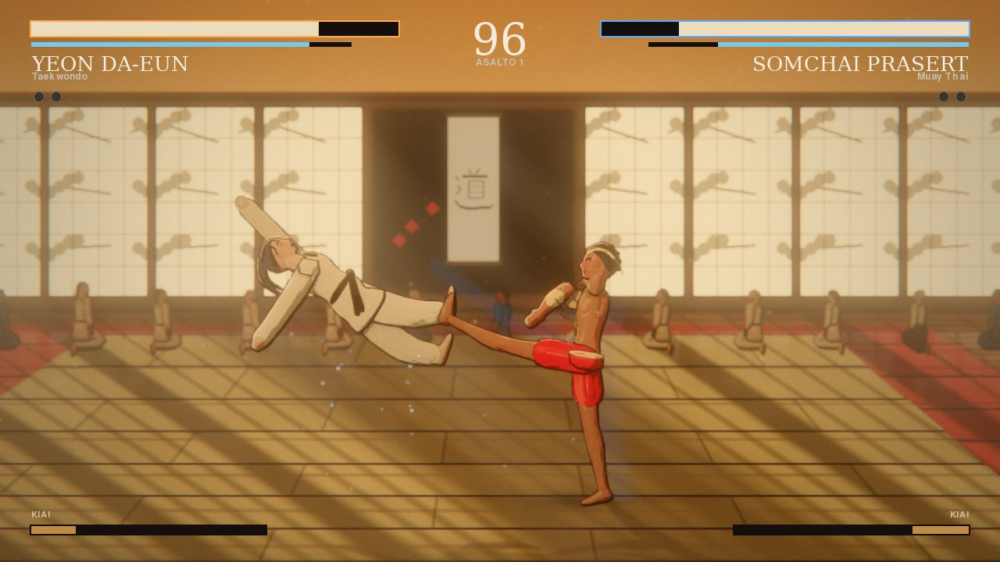
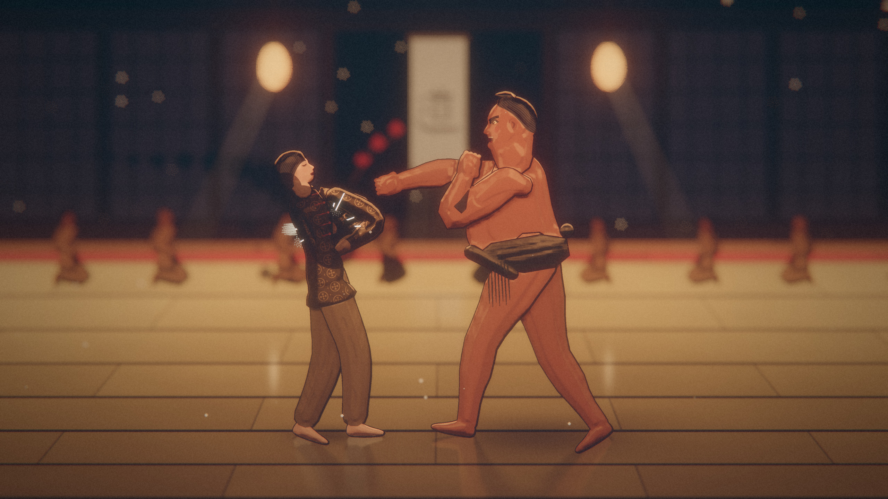
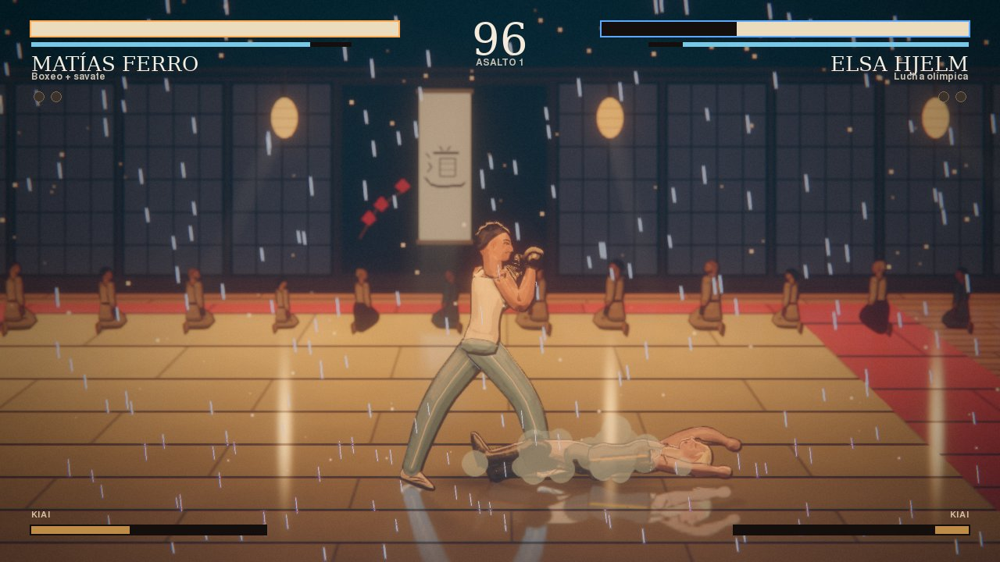
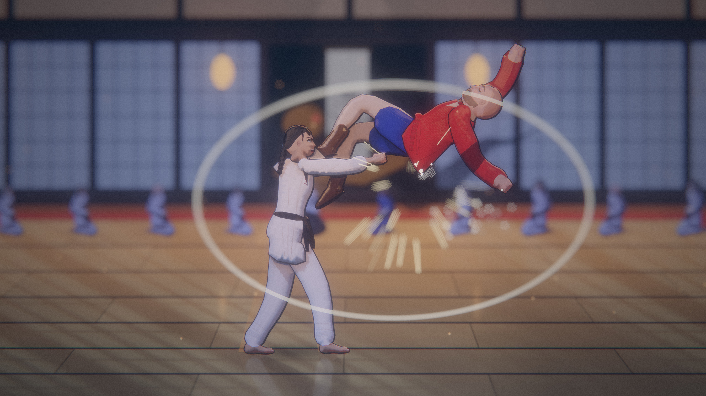
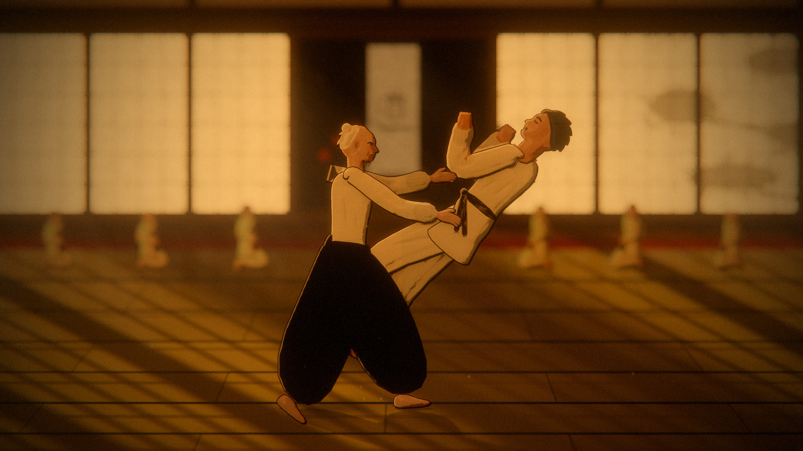
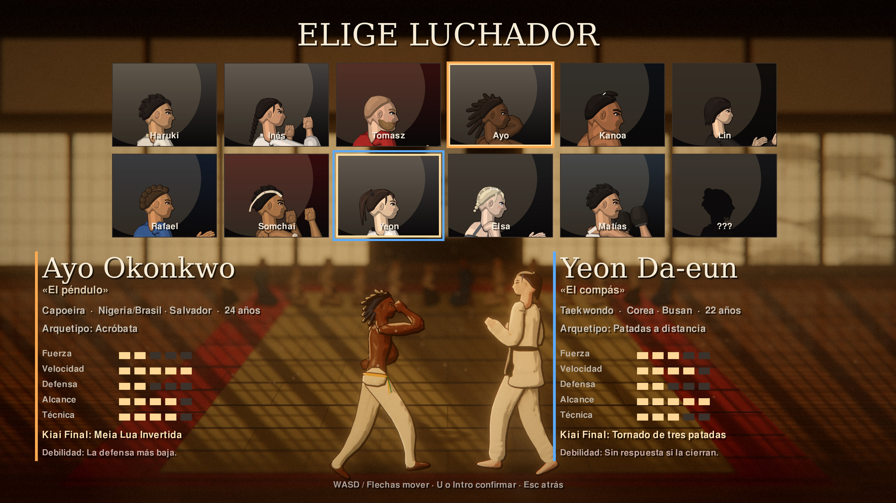
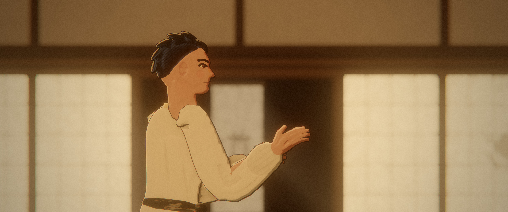
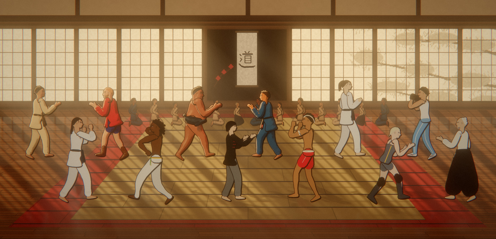
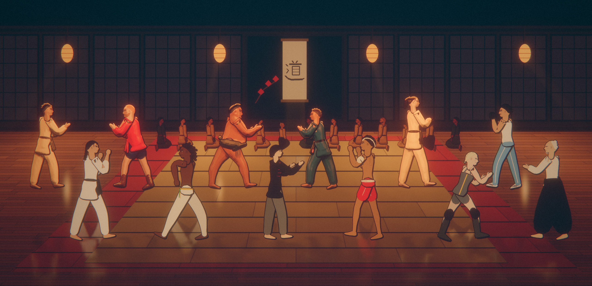
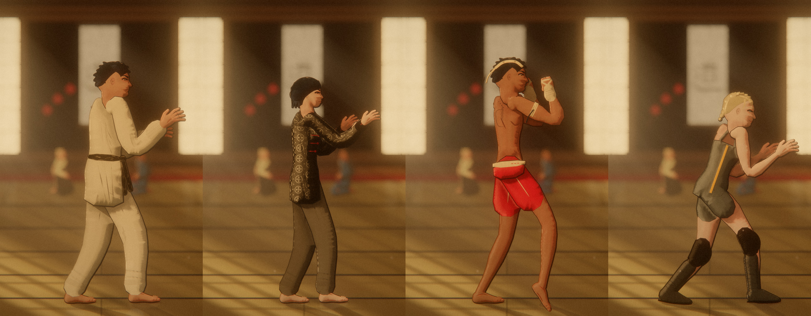

# 🥋 TATAMI: DŌ — Edición 2026 · `Tatamydo.py`

> Doce luchadores. Un dojo al atardecer. La luz se va apagando asalto a asalto.

Juego de lucha 2.5D, uno contra uno, en Python puro con pygame. Todo es procedimental:
no hay ficheros de arte ni de audio. El dojo Kōyō-kan, los doce luchadores, la tinta sumi-e,
el taiko y el shakuhachi se generan en el arranque.



| | |
|---|---|
|  |  |
|  |  |
|  |  |

Las imágenes son carteles renderizados por el propio motor a 3840×2160 y reducidos con Lanczos a
2560 px (`python tools/carteles.py`): cada una es un instante escenificado (el pie que llega, el cuerpo en
el aire, el kiai) encuadrado y gradado en el Modo Foto, con profundidad de campo y sin interfaz.

## Los luchadores




Cada luchador se dibuja con anatomía propia y no con cápsulas (`tatamido/anatomy.py` y `render_fighter.py`):

- **Siete tipos de cuerpo** con perfil de torso real (pecho, vientre, espalda, glúteo) y miembros que se
  estrechan con músculo: cuádriceps, gemelo, bíceps. Kanoa tiene vientre de sumo que tiembla al recibir.
- **Cabeza de perfil** con frente, nariz (recta, ancha, fina o rota dos veces), labios, mentón, mandíbula,
  oreja y ojo; expresiones de esfuerzo, grito, dolor, jadeo y sonrisa.
- **Rasgos de cada ficha:** orejas de coliflor de Haruki y Tito, cicatriz en la ceja de Inés, barba y
  rubor de Tomasz, rastas de Ayo, moño chonmage aceitado de Kanoa, flequillo recto de Lin, mongkol,
  prajied y tatuaje sak yant de Somchai, coleta alta de Yeon, trenza platino y pecas de Elsa, bigote,
  nariz rota y ojeras de Matías, moño blanco, barba rala, arrugas y manchas de Okabe.
- **Vestuario fiel:** judogi con solapa en V, cuello amarilleado y cinturón anudado (deshilachado en
  Haruki, con cuatro grados en Tito), kurtka con charreteras y botas de cuero, abadá con cordel amarillo
  y verde, mawashi con sagari, changshan con cuello mao y botones de lazo granate, pantalón corto de
  satén con cinturilla, dobok con cuello negro en V, singlet con franja y rodilleras de neopreno, camiseta
  de tirantes con chándal celeste y guantillas, y la hakama de siete pliegues dividida en dos perneras.
- **Una guardia por disciplina:** judo con las manos abiertas buscando el agarre, kyokushin con los puños
  altos, sambo agazapado, ginga de capoeira que oscila, sumo hundido, línea central del wing chun, ritmo
  de muay thai, rebote de taekwondo, cuclillas de lucha, bob and weave del boxeo y hanmi del aikido.
  Los golpes nacen de esa guardia y vuelven a ella.
- **Dibujo curvo, no poligonal:** brazos, piernas, mangas y perneras son *cintas* sobre una spline
  Catmull-Rom cuyo radio sigue un perfil anatómico con transiciones en coseno (deltoides que nace del
  hombro, bíceps, codo, antebrazo, muñeca; cuádriceps, rodilla, gemelo, tobillo). Las siluetas grandes
  pasan por suavizado de Chaikin; los detalles son pinceladas que engordan en el centro y se afilan en
  las puntas; el pelo se peina con mechones curvos y la coleta es un mechón afilado que se mece.
- **Tinta de peso variable:** el contorno engorda en el lado que se aleja de la luz y adelgaza en el
  iluminado, como un entintador a pincel.
- **Rostro diseñado:** ojo con iris del color de cada ficha, pupila y brillo, párpado superior grueso,
  cejas de pincel, nariz y rubor; puños cerrados con nudillos y manos abiertas con dedos para el agarre.
- **Tejidos diseñados, pieza a pieza (GPU):** el mapa de datos guarda en cada píxel el número de su
  pieza, y una tabla por fotograma da a la GPU el ancla, el eje, la escala, el material y el tejido de
  cada una. Así cada píxel sabe dónde está *dentro* de su manga, pernera, mechón o cinturón, en
  centímetros y orientado a lo largo de la pieza. Los tejidos siguen al miembro, giran con él y no
  resbalan; brazos y piernas se parten por el codo y la rodilla para que cada tramo lleve el suyo.
  Cada prenda tiene su tejido: grano de arroz acolchado del judogi de Haruki y Tito, lona de cesta del
  karategi de Inés y de la kurtka de Tomasz, sarga del dobok y de las perneras, damasco de seda con
  medallones tono sobre tono en el changshan de Lin, lino con hilos irregulares en el keikogi de Okabe,
  canalé en la camiseta de Matías, satén y lycra con pliegues que atrapan la luz, seda acanalada del
  mawashi, cuero con arrugas y cantos gastados, neopreno con canales, pespuntes en solapas y cinturones,
  y el cinturón negro de Haruki gastado hasta dejar ver el alma clara. El pelo se peina en mechones y
  hebras con un anillo de brillo que en el pelo negro es azulado y contenido.
- **Luz pintada:** el borde de la sombra se pinta con pinceladas que corren a lo largo de cada pieza y
  la sombra lleva trama; la seda, el satén y el pelo tienen brillos anisótropos en vetas, teñidos de su
  color; el algodón tiene pelusa a contraluz; la piel recibe menos saturación bajo luz cálida, rojeces en
  rodillas, codos y nudillos y un brillo graso suave; un relieve amplio redondea los cuerpos hacia la
  silueta y un degradado de ilustración enfría los pies y calienta la cabeza. Todo detalle se funde a su
  media antes de bajar de un píxel, sin moiré.



- **Iluminación por píxel de los sprites (renderer GPU):** cada luchador se dibuja dos veces, en color
  plano y en un mapa de altura y material. La GPU deriva normales de ese relieve y los ilumina con la luz
  real de cada asalto: piel con dispersión subsuperficial (borde de sombra cálido) y brillo del sudor,
  algodón con brillo de fibra, satén y lycra con especular, cuero brillante, pelo con banda de brillo,
  ambiente de cielo y rebote del tatami, oclusión ambiental, farolillos como luces puntuales y contraluz.
  Músculos, pliegues del judogi, de la hakama y del mawashi son surcos de relieve que la luz recorre.
- **Acabado:** contorno por capas de profundidad (el brazo delantero se recorta sobre el pecho), sombreado
  de tres tonos según la luz, sudor que hace brillar la piel, antebrazos que enrojecen al bloquear,
  supermuestreo 2× (3× en el preset *cine*) y contorno del color del jugador en los frames activos.

## Dirección de fotografía 2026

- **Cámara de juego de lucha moderno:** los luchadores ocupan alrededor de la mitad de la altura de la
  pantalla (antes, entre el 21 y el 33 %). El zoom sigue la distancia, se abre en los saltos y sube con
  ellos; Kiai Final, fase de suelo y repeticiones usan planos cerrados.
- **Sombreado anime de dos tonos:** rampa de luz con borde definido y suave, sombras de color desplazado
  (la piel hacia el rojo tibio, la tela hacia el azul del cielo), línea de dispersión subsuperficial en el
  borde de la piel, brillos duros de sudor, cuero y satén, anillo de luz en el pelo y contraluz recortado.
- **Contraste y profundidad:** menos neblina y bloom, curva de contraste más firme y desenfoque suave
  del fondo en juego (presets *alto* en adelante) para despegar los cuerpos.
- **Público real:** alumnos y un maestro del dojo sentados en seiza, dibujados con el mismo renderer.
- **Escalador dinámico de calidad:** si un fotograma se pasa de presupuesto, baja el supermuestreo de
  los luchadores antes que la fluidez, y lo recupera cuando sobra tiempo.

## Renderer 2026: shaders en la GPU

Si hay OpenGL 3.3 y `moderngl`, el juego usa un pipeline de shaders propio; si no, cae solo al
renderer de pygame. pygame dibuja las capas (fondo, luchadores, efectos, HUD) y la GPU hace la luz:

- **Resolución nativa:** el juego renderiza a 1080p, 1440p o 4K (`--res`, u opción *Resolución*; en
  `auto` elige por el escritorio: 1080p en Full HD, 1440p en QHD y en 4K). Las capas del mundo se
  dibujan a esa resolución. La interfaz se escribe en 1280×720 lógicos pero se pinta a la resolución
  de render (`tatamido/ui.py`): textos con la fuente al tamaño real, barras y retratos rasterizados a
  escala, nada reescalado desde 720p. Sólo se borra y se sube a la GPU la zona que cambió en cada
  fotograma (luchadores, público, y la interfaz por franjas horizontales).
- **Pared horneada:** techo con pilares y viga nageshi, enlucido de barro, pared de madera, doce shōji,
  tokonoma y farolillos se hornean una vez por luz de asalto en una lámina de alta resolución con
  máscara de materiales; la GPU la proyecta con la cámara (parallax incluido) y le pinta a resolución
  nativa washi con nubes de pulpa y fibras de kōzo, madera con veta, anillos y poros, y enlucido con paja.
  Al cambiar de asalto funde la lámina anterior con la nueva al ritmo de la luz. Los farolillos iluminan
  la madera de alrededor y la sombra de un pino de jardín cruza varios shōji.
- **Suelo procedural por píxel:** tatami de igusa con heri de algodón índigo, juntas, desgaste
  central y brillo distinto en cada estera; zona roja de seguridad; tarima de cedro con veta.
- **Luz de los shōji:** franjas de sol que cruzan el tatami con la sombra de la celosía (kumiko),
  penumbra que crece con la distancia y rayos volumétricos en pantalla que los cuerpos cortan.
- **Sombras proyectadas** de los luchadores y oclusión de contacto bajo los pies.
- **Farolillos** como luces puntuales sobre el suelo, con su reflejo alargado en el barniz.
- **Reflejos** de luchadores y pared en el suelo; en el desempate, suelo mojado con ondas de lluvia.
- **Luchadores iluminados por píxel** a partir de su mapa de altura y material (ver *Los luchadores*).
- **Estelas** de los golpes fuertes con la silueta real del luchador en el color del jugador.
- **HDR:** bloom de doble filtro, tonemapping AgX, gradación por asalto, aberración cromática,
  ondas de choque en los golpes fuertes, foco cenital y frame de impacto en el Kiai, viñeta,
  grano de película, profundidad de campo por CoC (Kiai, Modo Foto, menús), LUTs y FXAA.

```bash
python Tatamydo.py --renderer gpu    # auto (por defecto) | gpu | cpu
```

## Código

`Tatamydo.py` es el lanzador; el juego vive en el paquete `tatamido/`:

| Módulo | Qué hace |
|---|---|
| `config.py` · `data.py` | Constantes, presets gráficos, rigs de luz por asalto, los doce luchadores |
| `inputs.py` · `moves.py` | Teclado/mando con buffer de 7 frames, comandos clásicos, frame data por luchador |
| `fighter.py` | Máquina de estados, cancelaciones en golpe, Kiai Final, IA con personalidad |
| `anatomy.py` · `poses.py` · `render_fighter.py` | Cuerpos, rostros y vestuario de los doce; guardias por estilo; dibujo supermuestreado |
| `gpu.py` | Renderer de shaders: suelo procedural, sombras, rayos, reflejos, HDR, AgX, DoF, FXAA |
| `dojo.py` · `fx.py` · `postfx.py` | Kōyō-kan, polvo, lluvia, tinta sumi-e; posprocesado del renderer CPU |
| `match.py` · `replay.py` | Triángulo, puntuación, fase de suelo, repetición de ippon, grabación determinista |
| `game.py` | Escenas, menús, modos, Modo Foto, opciones y accesibilidad |
| `tests/` | `pytest`: determinismo, triángulo, técnicas únicas, contra, escapes, guardia rota, entrenamiento, repeticiones y todas las escenas con ambos renderers |

## Ejecutar

```bash
pip install pygame-ce numpy moderngl # moderngl activa los shaders; numpy, el sonido
python Tatamydo.py                   # resolución automática (F11: pantalla completa)
python Tatamydo.py --res 1440p       # 720p | 1080p | 1440p | 4k (renderer GPU)
python Tatamydo.py --preset cine     # portatil | bajo | medio | alto | ultra | cine
python Tatamydo.py --photo-mode      # arranca directo en el Modo Foto
python Tatamydo.py --ai-vs-ai        # espectador
python Tatamydo.py --debug-hitboxes
python -m pytest -q                  # tests de simulación
python tools/carteles.py             # regenera las imágenes de docs/ en 4K (--rs 1 --only 01 para un vistazo)
```

Por dentro, `--res` fija `TATAMIDO_RS` (1,5 = 1080p, 2 = 1440p, 3 = 4K): cámara, dojo, tinta y shaders
escalan sus medidas en píxeles, y los tejidos ganan una segunda octava (el hilo, los poros, las hebras)
que sólo aparece cuando hay píxeles para verla. El renderer CPU funciona a 720p.

## Controles

| Acción | J1 | J2 | Mando |
|---|---|---|---|
| Mover / saltar / agacharse | `WASD` | Flechas | Stick / cruceta |
| Golpe ligero · medio · fuerte | `U` `I` `O` | `Num 4` `5` `6` | X · Y · RB |
| Agarre | `J` | `Num 1` | A |
| Bloqueo (parada perfecta: 4 frames) | `K` | `Num 2` | B |
| Kiai Final (con la barra llena) | `L` | `Num 3` | RT |
| Técnica de estilo (única por luchador) | Atrás + Medio (moderno) · ↓↘→ + Medio (clásico) | | |
| Barrido / golpe aéreo | Agachado + Fuerte · Salto + golpe | | |
| Modo Foto · pausa (lista de técnicas) · hitboxes · frames | `F12` · `Esc` · `F1` · `F2` | | |
| Entrenamiento: muñeco · grabar · reproducir | `F3` · `F4` · `F5` | | |

## Qué hay dentro

- **Triángulo** golpe → agarre → bloqueo → golpe, parada perfecta con congelado de 8 frames,
  aliento (agotado: jadeo y −40 % de daño), barra de Kiai, hitstop, zoom de impacto y cámara lenta.
- **Técnica única por luchador:** Uchi Mata (agarre de comando), Ushiro Mawashi con armadura,
  Abrazo del oso que lleva al suelo, Aú Batido que se bloquea sólo de pie, Tsuppari multigolpe,
  Lin Wan Kuen en cadena, Puxada de guarda invulnerable, Teep de empuje, Dwi Chagi, Single Leg a la
  carrera, Uppercut anti-aéreo y el Irimi de Okabe, una guardia que devuelve el golpe proyectando.
- **Capa competitiva:** contraataque (+25 % al golpear en el arranque rival), escape de agarre
  pulsando agarre al ser agarrado (los de comando no se escapan), rotura de guardia al quedarse
  sin aliento bloqueando, armadura, golpes altos y bajos, invulnerabilidad.
- **Entrenamiento de verdad:** ventaja de frames tras cada golpe o bloqueo, cinco modos de muñeco
  (IA, quieto, bloquea todo, bloqueo aleatorio, salta) y grabación y reproducción en bucle de lo
  que hace el muñeco. La pausa incluye la lista de técnicas con datos de frames y propiedades.
- **Sensación de juego:** buffer de entrada de 7 frames (la pulsación en la recuperación no se
  pierde), cancelaciones en golpe (ligero → medio/fuerte/agarre, medio → fuerte/especial),
  escalado de daño por combo con contador en pantalla, estelas en los golpes fuertes.
- **Determinismo y repeticiones:** la lógica usa un generador propio por combate; cada combate
  terminado se graba en `./replays` (seed + máscara de botones por frame) y se reproduce desde el
  menú *Repeticiones*. Un test garantiza que grabación y directo producen el mismo estado.
- **IA** con cuatro niveles (Fácil a Maestro), consciente del borde del tatami, que castiga
  aturdimientos y usa su Kiai Final.
- **Puntuación japonesa:** waza-ari, ippon (con repetición automática en tres ángulos),
  jogai ×3, desempate por vitalidad y waza-ari. Asalto 4 bajo la lluvia.
- **Fase de suelo** para Sambo, BJJ y lucha: minijuego de tensión con cámara cerrada y viñeta.
- **Doce Kiai Finales** distintos (ráfagas, proyecciones, tornado, oshidashi, gancho al hígado,
  Kokyū Nage pasivo de Okabe que devuelve cada parada perfecta).
- **Iluminación narrativa** por asalto: tarde dorada, hora azul y noche de farolillos; haces
  volumétricos, polvo en suspensión, sombra del pino sobre los shōji, hoja de arce que cae en el
  último asalto, público de 14 personas que reacciona y aplaude al ippon.
- **Daño visible:** sudor, rojeces en antebrazos, solapa descolocada, cinturón que se afloja.
- **Legibilidad:** siluetas con contorno oscuro, cámara más cerrada, reflejos de los luchadores en
  el tatami barnizado bajo los farolillos, tarjetas de presentación al empezar cada combate.
- **Modos:** Versus local, Versus IA, Arcade con epílogos, Torneo (desbloquea al Sensei Okabe si
  no pierdes un asalto), Entrenamiento con datos de frames, Espectador.
- **Modo Foto:** encuadre libre, zoom, exposición, bokeh, grano y LUTs *Caravaggio*, *Hammershøi*,
  *Kurosawa B/N* y *Daido Moriyama*; exporta PNG con supermuestreo 2× a `./fotos`.
- **Accesibilidad:** reducción de destellos, temblor de cámara desactivable, alto contraste y
  filtros de daltonismo. Progreso y opciones en `~/.tatamydo_save.json`.

Código bajo licencia MIT. Todos los luchadores y el dojo son ficticios.

> *「礼に始まり礼に終わる」 — Empieza con un saludo, termina con un saludo.*
